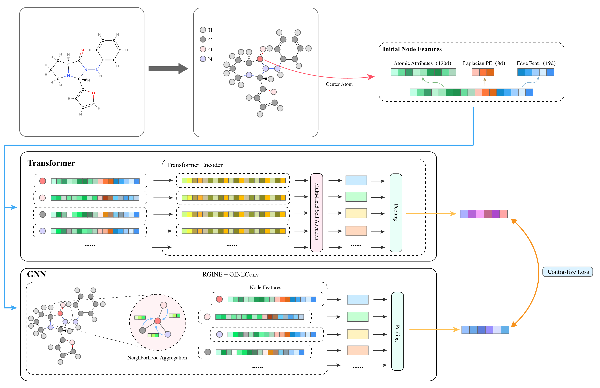

# MolGTC: Dual-Tower GNN-Transformer Contrastive Learning Framework



## Model Architecture

MolGTC adopts a dual-tower architecture consisting of:

1. **GNN Branch** - Based on RGINE with GINEConv layers. Captures local topological structures and chemical bond information.
2. **Transformer Branch** - Based on multi-head self-attention. Extracts global atomic features and long-range dependencies.
3. **Contrastive Learning** - NT-Xent loss aligns representations from both branches.

Each molecule is represented as a **147-dimensional node feature**:
- 120-dim atomic one-hot encoding (119 atomic numbers + chirality)
- 8-dim Laplacian positional encoding (LapPE)
- 19-dim aggregated edge features

## Pre-training

```bash
python Convert_Fusion_Sample.py
python Pretrain.py
```

## Fine-tuning

```bash
# Edit data_path and pretrained_weights in finetune_config.yaml first
python finetune.py
# Full-data training
python train_production.py
```